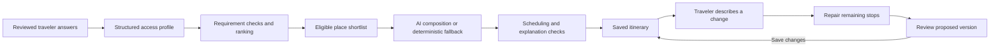

# Limitless

### Your world to discover. Your right to explore.

**Accessible travel planning built around every traveler.**

Limitless helps travelers plan San Diego trips around their access needs, interests, stamina, and pace—and adjust those plans when the day changes.

**[Try Limitless](https://limitless-rouge.vercel.app)** · [Run locally](#run-locally) · [Architecture](docs/architecture.md) · [Deployment](docs/deploy.md)

Built at **DubHacks ’26** with Next.js, TypeScript, FastAPI, Python, and Supabase/Postgres.

## The inspiration

A torn ankle ligament changed how our teammate Sashwath experienced travel. He could not walk and needed wheelchair assistance and rebooking. He still wanted to explore, but the journey suddenly required arrangements he had never needed before.

That experience raised a question: **why should a change in someone’s needs make travel so difficult to plan?**

For a wheelchair user, an accessible entrance is only part of the picture. Slopes, distances, restrooms, and places to rest can determine whether a day is manageable. For a traveler who is Deaf or hard of hearing, captions and written communication can shape the experience just as much as the destination itself.

The [World Health Organization](https://www.who.int/news-room/fact-sheets/detail/disability-and-health) estimates that 1.3 billion people—approximately one in six worldwide—experience significant disability. We built Limitless to keep the excitement of travel at the center while making individual needs part of the planning process.

## What you can do

| Feature | The traveler’s experience |
| --- | --- |
| **Personalized planning** | Answer a short, adaptive questionnaire about access needs, interests, walking comfort, pace, and travel dates. |
| **Voice or text** | Speak an answer, review the transcript, and confirm it—or use the regular form controls. |
| **A manageable daily itinerary** | Explore day-by-day activities, meal stops, breaks, travel estimates, and weather forecasts when available. |
| **My trips** | Save itineraries under a guest profile with an optional nickname. No email or password is required. |
| **Edit with AI** | Describe a problem or request—“less walking,” “more museums,” or “try different stops”—and review suggested changes before saving. |
| **Manual control** | Skip or restore stops, keep selected stops during replanning, add personal notes, and delete a trip after confirmation. |
| **A conversational travel guide** | Ask the homepage assistant about travel preparation and how to use Limitless. |
| **Reasons behind suggestions** | Read why a stop was selected, explore supporting source links, and see why other places were excluded. |

The backend separates **Accessibility Score**, which describes personal fit, from **Verification Score**, which describes confidence in the supporting information. Venue research draws on official venue websites and government accessibility resources, with source references retained in the place details.

## Try the flow

1. Open **[Limitless](https://limitless-rouge.vercel.app)** and choose **Plan your trip**.
2. Continue as a guest and answer the questions that apply to you. Voice input is optional.
3. Review what the planner understood, then choose **Plan my trip**.
4. Switch between days, explore the stop details, and mark your progress.
5. Open **My trips** whenever you want to revisit, edit, or delete your itinerary.
6. To change the day, choose **Edit with AI**, describe what you need, and select **Update my plan → Save changes**. **Undo** restores the earlier version.

You can also open **See a sample itinerary** from the homepage before creating a profile.

## How it works



**Rules decide suitability; AI helps interpret and explain.** The planner evaluates places against the traveler’s requirements before sending a shortlist to the language model. The scheduler then balances visit duration, travel estimates, breaks, and daily effort. If AI composition fails, a deterministic planning path can still assemble an itinerary.

**Adaptation preserves the trip already underway.** Completed, in-progress, skipped, and explicitly kept stops are protected during repair. Proposed versions remain separate from the saved plan until the traveler accepts them.

**Accessibility includes the interface itself.** One question at a time, labeled controls, keyboard navigation, visible focus, screen-reader announcements, and reviewed voice input make the planning interaction part of the solution.

For the code paths, boundaries, and developer notes, see the [architecture guide](docs/architecture.md).

## Built with

| Layer | Technology and responsibility |
| --- | --- |
| Web application | Next.js App Router, React, TypeScript, Tailwind CSS |
| Application API | FastAPI, Python, Pydantic |
| Identity and persistence | Supabase Auth, Postgres, pgvector |
| AI | OpenAI structured extraction, itinerary composition, conversation, and transcription |
| Planning | Deterministic requirement checks, ranking, neighborhood grouping, scheduling, and versioned repair |
| Weather | Open-Meteo daily forecasts for San Diego |
| Deployment | Vercel frontend, Render API, Supabase database |
| Verification | Pytest, TypeScript, ESLint, Node tests, Playwright |

## Repository map

```text
api/                  FastAPI application, planning services, models, and tests
web/                  Next.js interface, server routes, and browser tests
supabase/migrations/  Database schema, access rules, and SQL functions
data/                 Venue research and import inputs
scripts/              Shared tooling and API type generation
docs/                 Architecture, deployment, and quality review
```

## Run locally

### Prerequisites

- Node.js **24** and npm.
- Python **3.12+** and [uv](https://docs.astral.sh/uv/).
- A configured Supabase development project with the repository’s migrations applied.
- OpenAI credentials for profile extraction, composition, chat, and transcription.

Enable **Allow anonymous sign-ins** under **Authentication → Sign In / Providers** in Supabase. The web app and API must use the same Supabase project.

### 1. Configure the environment

Use [`.env.example`](.env.example) as the variable reference. Create the two local files below; keep real credentials out of Git.

**`api/.env`**

```dotenv
DATABASE_URL=your_supabase_session_pooler_connection_string
SUPABASE_URL=https://your-project.supabase.co
SUPABASE_SECRET_KEY=your_server_only_secret_key
OPENAI_API_KEY=your_openai_key
ALLOW_DEMO_AUTH=false
CORS_ORIGINS=["http://localhost:3000"]
```

**`web/.env.local`**

```dotenv
NEXT_PUBLIC_API_URL=http://localhost:8000
NEXT_PUBLIC_SUPABASE_URL=https://your-project.supabase.co
NEXT_PUBLIC_SUPABASE_PUBLISHABLE_KEY=your_publishable_key
OPENAI_API_KEY=your_openai_key
```

Only the Supabase publishable key belongs in a `NEXT_PUBLIC_*` variable. The Supabase secret key and OpenAI key stay server-side. Model choices are configurable through the variables in `.env.example`.

### 2. Start the API

From the repository root:

```bash
cd api
uv sync
uv run fastapi dev app/main.py
```

API: **http://localhost:8000** · Interactive API docs: **http://localhost:8000/docs**

### 3. Start the web app

In a second terminal, from the repository root:

```bash
cd web
npm ci
npm run dev
```

Open **http://localhost:3000**. Restart the relevant server after changing environment variables.

More detail: [API setup](api/README.md) · [Web development](web/README.md) · [Deployment](docs/deploy.md)

## Quality and testing

From `api/`:

```bash
uv run pytest
```

From `web/`:

```bash
npm run lint
npx tsc --noEmit
npm run test:chat
npm run test:transcribe
npm run test:questionnaire-voice
npm run build
PLAYWRIGHT_CHANNEL=chrome npm run test:e2e
```

Browser tests can use installed Chrome, or Playwright’s Chromium after installation. The suite checks navigation, questionnaire branching, voice-review behavior, saved trips, and itinerary actions. Backend tests exercise scoring, scheduling, ownership, and replanning. See the [quality review](docs/quality-review.md) for the recorded checks and testing limits.

When API models change, regenerate the shared contract from the repository root:

```bash
./scripts/gen-types.sh
```

Do not edit `api/openapi.json` or `web/types/api.d.ts` by hand.

## Where we want to take it

Our goal is a service that combines personalized planning, ongoing assistance, and human judgment when automation is insufficient.

- **First:** focused San Diego coverage across beaches, restaurants, and attractions, with stronger review workflows.
- **Next:** selected California cities supported by trained local reviewers.
- **Then:** West Coast expansion as demand and operating capacity grow.
- **Human support:** build a staffed handoff process and grow coverage toward a 24/7 support service. Automated human escalation is a roadmap feature.
- **Continuity:** add linked accounts for access across devices and improve integrations with travel providers.

Potential revenue includes traveler services, partnerships, venue listings, and booking commissions. Our principle is that commercial payments must never determine personal-fit or verification scores.

## The team

- **Chendur Jayavelu** — backend, planning, AI, and infrastructure.
- **Akshith Saravanan** — frontend, interaction design, and accessibility.
- **Sashwath Narayanan** — product, research, and travel experience.

**Limitless — Your world to discover. Your right to explore.**
