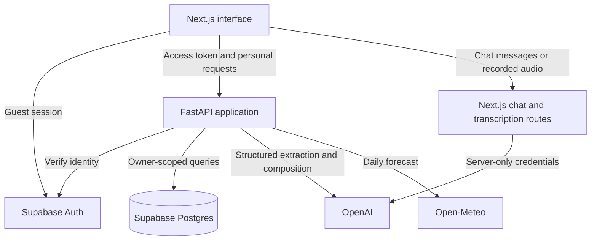

# How Limitless fits together

This guide maps the working prototype to its main files. Start with the [product README](../README.md), [API setup](../api/README.md), and [web development guide](../web/README.md).

## Application boundaries

Supabase authenticates the traveler. FastAPI owns profiles and itineraries. Next.js server routes own homepage conversation and audio transcription. The homepage assistant has no tools for reading or modifying saved trips.

## Identity and ownership

- [`GuestGate.tsx`](../web/components/GuestGate.tsx) restores the existing guest session before showing personal controls. New identities are created through the guest form.
- [`guest-auth.ts`](../web/lib/guest-auth.ts) shares one browser auth client and retrieves its access token.
- [`deps.py`](../api/app/deps.py) verifies that token with Supabase Auth. A client-supplied user ID is not proof of ownership.
- [`db.py`](../api/app/db.py) scopes personal queries to the verified user ID. This is necessary because the server connection is privileged; database RLS cannot replace these checks.
- [`main.py`](../api/app/main.py) prevents caching of personal responses.

Clearing browser storage or changing devices can lose access to an unlinked guest identity. Linked accounts are future work.

## Reviewed answers become a profile

| File | Responsibility |
| --- | --- |
| [`intakeQuestions.ts`](../web/lib/intakeQuestions.ts) | Questions, visibility rules, and migration of older answers into notes. |
| [`IntakeWizard.tsx`](../web/components/IntakeWizard.tsx) | Guest-scoped drafts, shape validation, branching, focus, and progress. |
| [`QuestionField.tsx`](../web/components/QuestionField.tsx) | Labeled, question-specific form controls. |
| [`QuestionVoiceInput.tsx`](../web/components/QuestionVoiceInput.tsx) | Recording, transcript review, and explicit confirmation. |
| [`questionnaire-voice.ts`](../web/lib/questionnaire-voice.ts) | Deterministic parsing against the question’s allowed choices. |
| [`trip-dates.ts`](../web/lib/trip-dates.ts) | Calendar validation and night counts independent of DST. |
| [`IntakeSubmit.tsx`](../web/components/IntakeSubmit.tsx) | Submit visible answers, review the profile, and create a trip once. |
| [`intake.py`](../api/app/routers/intake.py) | Store and expose owned profiles. |
| [`dna.py`](../api/app/models/dna.py) | Typed Accessibility DNA and derived planning limits. |

Accessibility DNA is the internal name for a profile of requirements and preferences. It does not describe a diagnosis. Must-haves remain distinct from nice-to-haves, and missing answers remain unknown.

## Voice lifecycle and accessible feedback

[`audio-recorder.ts`](../web/lib/audio-recorder.ts) owns capture and transcription. Run IDs discard late permission or fetch results after cancellation. Tracks are released when recording ends. [`speech.ts`](../web/lib/speech.ts) exposes this lifecycle to React and prevents simultaneous recordings across controls.

[`/api/transcribe`](../web/app/api/transcribe/route.ts) checks origin, media type, size, and request rate, then forwards audio with a server-only provider key. It returns editable text. The app does not persist an audio file; the transcription provider still receives the recording.

[`LiveRegion.tsx`](../web/components/LiveRegion.tsx) announces progress and errors without moving focus. Questionnaire transitions separately focus the new heading. Speech input still requires traveler review before applying an answer.

## The planning pipeline

1. [`facts.py`](../api/app/services/facts.py) resolves competing records per attribute. Negative evidence takes precedence, older checks can lose confidence, and missing attributes remain unknown.
2. [`rules.py`](../api/app/services/rules.py) defines applicable barriers, penalties, and supporting features.
3. [`scoring.py`](../api/app/services/scoring.py) evaluates a place for this traveler. Interest and rating affect rank but cannot cancel a hard exclusion.
4. [`planner.py`](../api/app/services/planner.py) builds day shortlists and selects AI composition or deterministic fallback.
5. [`compose.py`](../api/app/llm/compose.py) constrains generated place IDs to the request’s shortlist.
6. [`grounding.py`](../api/app/validators/grounding.py) checks citation ownership and applies wording/number heuristics. These are guardrails, not complete semantic verification.
7. [`scheduler.py`](../api/app/services/scheduler.py) calculates times, meals, breaks, travel estimates, and relative effort. It can remove lower-ranked visits when limits are exceeded; its last-visit behavior is explicit in `lay_out`.

[`weather.py`](../api/app/services/weather.py) fetches San Diego forecasts when a plan is generated. Unsupported dates and failed requests have no forecast. Saved plans do not refresh weather continuously.

### Current score display

The backend calculates personal-fit and verification indicators. At the team’s request, `Scores` in [`ItineraryView.tsx`](../web/components/itinerary/ItineraryView.tsx) currently overrides **displayed** accessibility to 100 and verification to a stable 90–100 per place. A tooltip identifies test values. API scores, evidence, and filtering remain unchanged. Restore `item.accessibility_score` and `item.verification_score` to display the calculated values again.

The energy number is a relative planning estimate based on visit duration, exertion, and the chosen pace budget. It is not a health measurement.

## Saved trips and changes

[`SavedTrips.tsx`](../web/components/SavedTrips.tsx) shows recent owned trips. Deletion requires confirmation; the card disappears only after a successful API response. [`TripScreen.tsx`](../web/components/itinerary/TripScreen.tsx) loads personal trips through the guest gate. Only two allowlisted sample IDs bypass it, and those render read-only.

The AI-edit flow is:

1. [`TellLimitless.tsx`](../web/components/itinerary/TellLimitless.tsx) submits reviewed text. Request IDs discard responses from cancelled interactions.
2. [`trips.py`](../api/app/routers/trips.py) checks ownership, parses intent, and constructs trip-specific overrides.
3. [`replan.py`](../api/app/services/replan.py) repairs editable remaining stops. Completed, in-progress, skipped, and kept stops remain protected; the prefix through a protected stop stays intact.
4. [`db.py`](../api/app/db.py) saves a proposed version using a transaction and row lock. The current version stays unchanged.
5. **Save changes** applies that version. **Undo** selects the earlier snapshot.

[`ManualItineraryEditor.tsx`](../web/components/itinerary/ManualItineraryEditor.tsx) changes status, keep flags, and personal notes without rescheduling or creating accessibility evidence. Repair carries notes forward for places that remain.

## Explanations and external links

[`ItineraryView.tsx`](../web/components/itinerary/ItineraryView.tsx) organizes days, stop controls, and excluded places. [`StopDetails.tsx`](../web/components/itinerary/StopDetails.tsx) keeps explanations visible and supporting details expandable.

[`trip-evidence.ts`](../web/lib/trip-evidence.ts) matches external links by exact venue name/alias, sanitizes URLs, deduplicates citations, and exposes opposing records. Venue links open provider websites; they do not confirm availability or create reservations in Limitless.

## Shared contracts and verification

[`api.py`](../api/app/models/api.py) defines the HTTP contract. `scripts/gen-types.sh` exports OpenAPI and generates TypeScript definitions. Frontend [`api.ts`](../web/lib/api.ts) centralizes bearer headers and errors around that contract.

Pytest covers rules, scheduling, and API ownership; Node tests cover parsers and server routes; TypeScript and ESLint check the web code; Playwright exercises traveler flows. See the [quality review](quality-review.md) for recorded checks and known limits.

## Future service boundaries

The prototype provides planning, guest persistence, conversational guidance, and itinerary editing. Automated human-support escalation, staffed 24/7 coverage, linked accounts, integrated bookings/payments, and a review-operations dashboard are future work.
